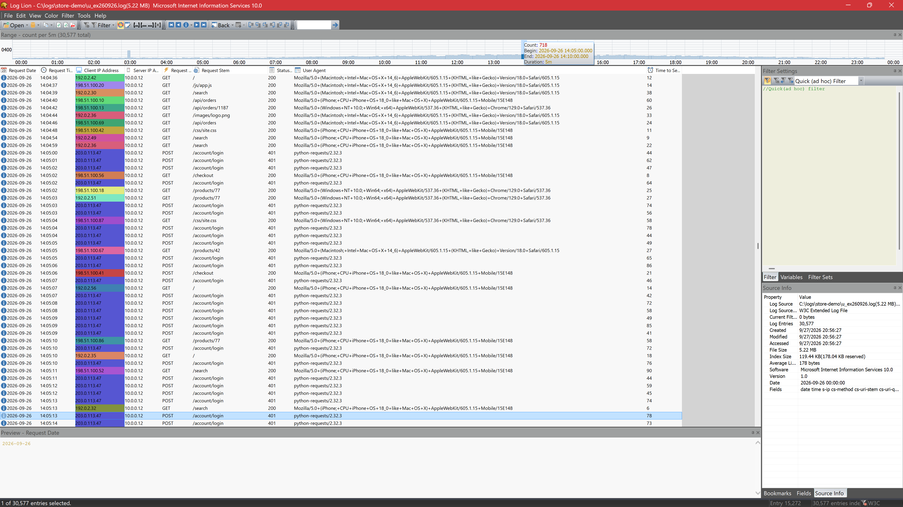
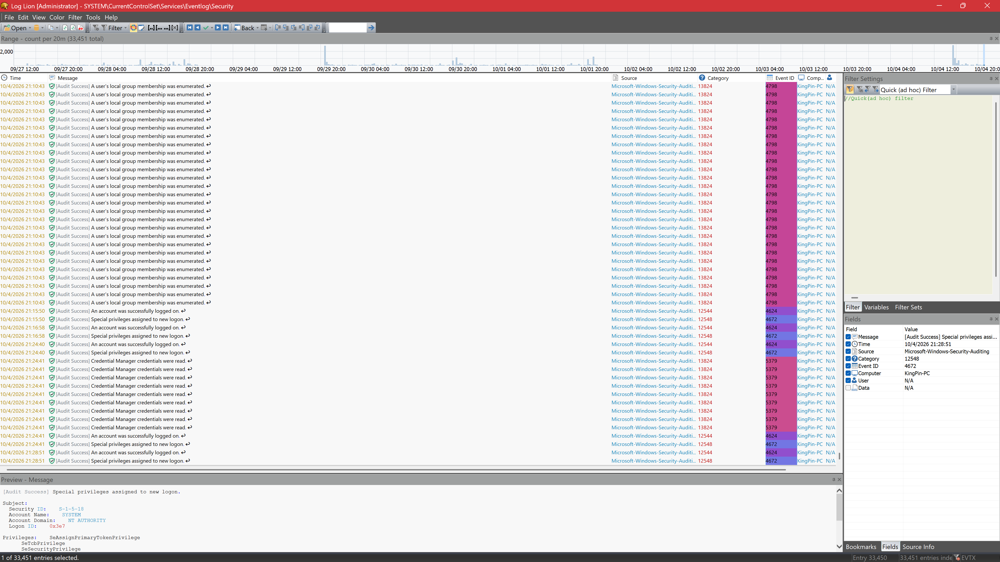
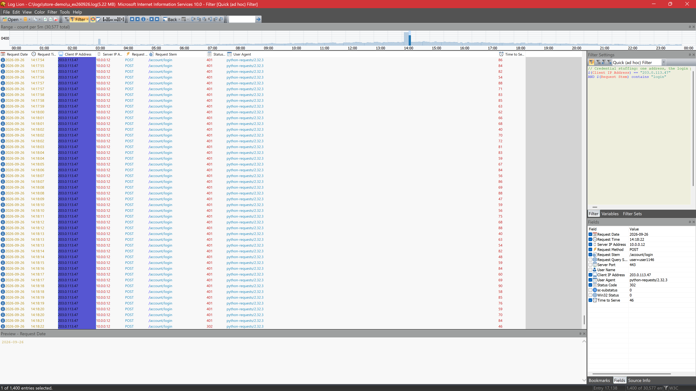
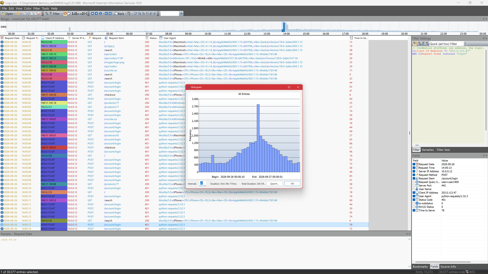
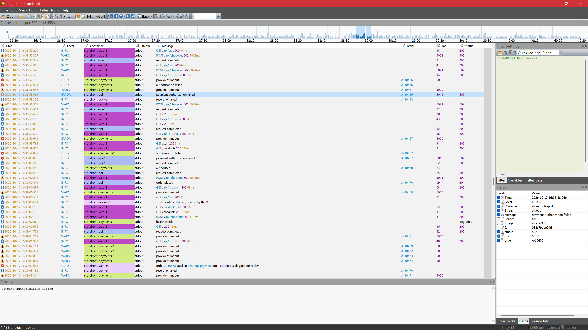

  

<h1 align="center">Log Lion</h1>

  <b>Professional log analysis for Windows.</b> 
  Windows Event Logs, ETW traces, firewall and web server logs, JSON, and nearly any text log, 
  with color that shows the pattern before you search for it.

  <a href="https://apps.microsoft.com/detail/9pfz6dqlth5q">Microsoft Store</a> ·
  <a href="https://www.regallogic.com/">Website</a> ·
  <a href="docs/README.md">Documentation</a> ·
  <a href="https://github.com/RegalLogic/loglion/discussions">Discussions</a> ·
  <a href="https://github.com/RegalLogic/loglion/issues/new/choose">Report a problem</a>

This repository is Log Lion's public home on GitHub: the place to report bugs, ask for
features and log formats, ask questions, and read the documentation. Log Lion itself is
commercial software from [Regal Logic](https://www.regallogic.com/), and its source code
is not here.

## What it is

Log Lion is a fast, read-only log viewer and analyzer for Windows, made for IT
administrators, security and incident responders, forensic examiners, and developers.

- **Color does the reading.** Syntax highlighting inside every message, a color for every
  distinct value of a column (thread, session, client address), highlight rules, and filters
  that color what they match instead of hiding the rest.
- **Built for Windows logs.** Live event logs and `.evtx` files, legacy `.evt` files left
  unclosed by a crash, ETW `.etl` traces, Windows Defender Firewall logs, and debug output
  captured live, including from services.
- **And everything else.** Plain text, JSON and JSON Lines, logfmt, CSV and TSV, W3C/IIS,
  HAR, BSON, MSI logs, SQL databases, binary files, and your own formats through the Import
  Text Log Wizard or a regular expression.
- **Filters that scale.** A boolean filter language over any column, applied to logs of
  many gigabytes, plus a timeline, ranges, and bookmarks.
- **Analysis tools.** Histogram, subtotals, statistics, a profiler, unmatched pairs, open
  scopes, a word counter, and Lua scripts for the questions they don't answer.
- **Never modifies a log.** Safe for evidence.

| | |
| --- | --- |
|  |  |
|  |  |

## Get Log Lion

- **Personal:** [Log Lion on the Microsoft Store](https://apps.microsoft.com/detail/9pfz6dqlth5q),
  with a 30-day free trial.
- **Teams and organizations:** a flat yearly license for every employee and machine, with a
  signed MSI installer for silent deployment. See
  [pricing](https://www.regallogic.com/pricing/pricing.html) and
  [Log Lion for the enterprise](https://www.regallogic.com/enterprise/enterprise.html), or
  email [sales@regallogic.com](mailto:sales@regallogic.com).

Log Lion runs on Windows 10 and Windows 11, x64.

## Enterprise extensions

Extensions built and signed by Regal Logic read the systems your services run on, next to
the files they leave behind. Each is listed under **File ▸ Open Source**.

| Extension | Reads | Since |
| --- | --- | --- |
| Docker | Every container of a compose project, or the ones you pick, merged by time and followed live | 3.1.3 |
| Splunk | Events from Splunk Enterprise or Splunk Cloud through its search API | 3.1.4 |
| Grafana MCP | Logs in ClickHouse or Loki, through a Grafana MCP server, with your filters run on the server | 3.1.4 |

Need a system that isn't listed? [Request an extension](https://github.com/RegalLogic/loglion/issues/new?template=extension_request.yml).

## Documentation

The [documentation](docs/README.md) is the same user guide you get by pressing **F1** in
Log Lion. Good places to start:

- [Quick Start](docs/quick-start.md)
- [Opening Logs](docs/opening-logs.md), and every supported format
- [Filtering](docs/filtering.md) and the [filter language](docs/filter-language.md), with [samples](docs/filter-samples.md)
- [Keyboard Shortcuts](docs/keyboard-shortcuts.md)
- [Deploying Log Lion in an organization](docs/deployment.md)
- [What's new](https://www.regallogic.com/whats-new/whats-new.html), on our website

## Feedback and support

| You want to | Go to |
| --- | --- |
| Report a bug or a crash | [New bug report](https://github.com/RegalLogic/loglion/issues/new?template=bug_report.yml) |
| Ask for a feature | [New feature request](https://github.com/RegalLogic/loglion/issues/new?template=feature_request.yml) |
| Ask Log Lion to read a log format | [New log format request](https://github.com/RegalLogic/loglion/issues/new?template=log_format.yml) |
| Ask a question or share a filter, script, or tip | [Discussions](https://github.com/RegalLogic/loglion/discussions) |
| Get help with a license, purchase, or refund | Email [contact@regallogic.com](mailto:contact@regallogic.com) |
| Report a security vulnerability | See [SECURITY.md](SECURITY.md); please don't open an issue |

Before you post, search the [existing issues](https://github.com/RegalLogic/loglion/issues)
and give the ones you'd like a 👍. We read the votes when planning. See
[SUPPORT.md](SUPPORT.md) for what to include.

Logs often hold names, addresses, and secrets. **Don't attach a log to a public issue
unless you're sure it's safe to share.** Trim it to the lines that show the problem and
replace anything sensitive, or offer to send it to us privately.

---

Copyright © Regal Logic LLC. The documentation in this repository is provided for use with
Log Lion; see [LICENSE](LICENSE).
