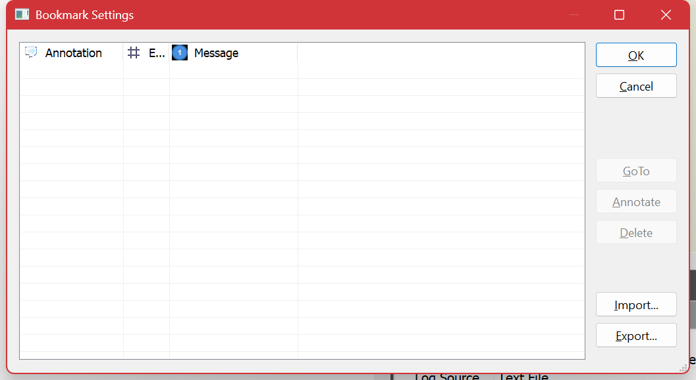

# Bookmarks

A bookmark marks an entry you want to come back to. Working through a long log usually means finding half a dozen interesting moments scattered across it before you understand the whole picture — bookmarks are how you keep them without losing your place.

## The commands

| Command | Key |
| --- | --- |
| **Toggle** a bookmark on the current entry | Ctrl+F2 |
| **Go to Next** bookmark | F2 |
| **Go to Previous** bookmark | Shift+F2 |
| **Clear All** | Ctrl+Shift+F2 |
| **Bookmark Settings** | Alt+F2 |

All of them are under **Edit ▸ Bookmarks**. A bookmarked entry is drawn in a distinct style in the entry list, so you can see them as you scroll past.

## The Bookmarks pane

The **Bookmarks** pane — tabbed beside **Fields** and **Source Info** — lists every bookmark in the log with its entry number and text. Click one to jump to it. This is the useful view when you have collected several: it is a table of contents for the investigation you are in the middle of.

## Bookmark Settings

**Alt+F2** opens the settings, where bookmarks can be reviewed, annotated and removed in bulk rather than one at a time.

## Bookmarks and filters

**Filter ▸ Include Bookmarks** (**Ctrl+Shift+M**) makes every filter keep your bookmarked entries regardless of whether they match.

This is more useful than it first sounds. A filter is a blunt instrument: it shows what matches and hides everything else, including the one line you already knew was important. With **Include Bookmarks** on, you can bookmark the handful of entries that matter, then filter aggressively, and still see them in place among the results. It is the way to build up a narrative — "these five entries, plus everything about session 42".

## Do bookmarks persist?

Bookmarks belong to the log you are reading, and formats that can store them do. Log Lion never writes to your log file to record one — see the note on [read-only handling](working-with-logs.md) — so for an ordinary file they last for the session.

If you need marks that outlive the session, two alternatives keep better:

- A **saved filter** that selects the entries by their content. See [Filtering](filtering.md).
- An **export** of the entries themselves, as HTML or CSV. See [Exporting and Copying](exporting.md).

## Related

- [Navigating](navigating.md) — Alt+Left steps back through where you have been, which covers the "I was just there" case without a bookmark at all.
- [Coloring](coloring.md) — for marking a *class* of entry rather than individual ones.

---

[All documentation](README.md)
