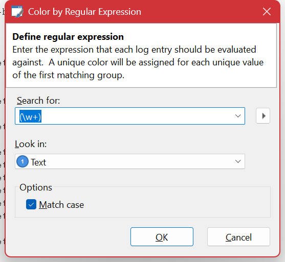

# Coloring

A filter answers a question you already know to ask. Color is how you find the question — it makes structure visible in a log you have not understood yet, without hiding anything.

The **Color** menu holds several independent modes. **Color ▸ None** turns the lot off.

## Syntax Highlighting

On by default, and format-independent. Log Lion picks out structure inside the message text — numbers, quoted strings, `name=value` pairs, GUIDs, hex values and identifier-like slugs — and colors each kind differently.

It needs no configuration and is usually enough on its own to let you pick a value out of a dense line at a glance. The rules live in `%APPDATA%\Log Lion\SyntaxColoringRules.xml`; delete that file to go back to the defaults.

## Column

**Color ▸ Column** colors each entry by the value of a column you choose, giving every distinct value its own color automatically. There is nothing to configure — you pick the column, Log Lion hashes the values into colors.

This is the most under-used feature in the product and frequently the fastest route to an answer. Color by **thread** and interleaved work separates into visible strands. Color by **session** or **request id** and you can follow one transaction down the page without filtering the others away — so you still see what else was happening at the time, which is exactly what a filter would have hidden. Color by **level** and the shape of a bad period is obvious from the scrollbar down.

## Highlight Expression

**Color ▸ Highlight Expression** (Ctrl+Shift+R) colors entries matching regular expressions you supply. Several rules can be active at once, each with its own color.

Where [Find](finding.md) visits matches one at a time, this marks them all at once and leaves them marked while you scroll. When you are trying to see how often something happens and in what company, that is the difference between counting and seeing.

Rules can be kept as named **regular expression profiles** so a set you have tuned for one kind of log is a couple of clicks away next time. They are stored in `%APPDATA%\Log Lion\RegExProfiles.xml`.

## Filter Result Set

**Color ▸ Filter Result Set** (Ctrl+Shift+S) colors the entries that match the current filter *instead of* hiding the ones that do not.

This is the answer whenever a filter is nearly right but throws away too much context. Write the expression, switch to coloring by it, and read the log normally with the matches marked in place. It is also a good way to develop a filter: you can see what it is catching and what it is missing at the same time.

## Alternating Rows

**Color ▸ Alternating Rows** shades every other row. Worth turning on for wide formats with many columns, where the eye otherwise drifts between rows.

## Indention Level

**Color ▸ Indention Level** colors entries by how deeply nested they are, for formats that have a [navigation context](navigating.md). Depth becomes visible as a band of color rather than something you have to count, which makes an operation that failed to unwind stand out.

## Choosing a mode

| If you want to… | Use |
| --- | --- |
| Read individual entries more easily | Syntax Highlighting |
| Separate interleaved work by thread, session or request | Column |
| Mark everything matching a pattern | Highlight Expression |
| Keep a filter's context | Filter Result Set |
| See nesting depth | Indention Level |
| Track a wide table across the page | Alternating Rows |

## Color survives export

Copying or exporting as **HTML** or **RTF** keeps the coloring you are looking at, near enough to what is on screen to paste straight into a ticket, a mail or a report. See [Exporting and Copying](exporting.md).

---

[All documentation](README.md)
