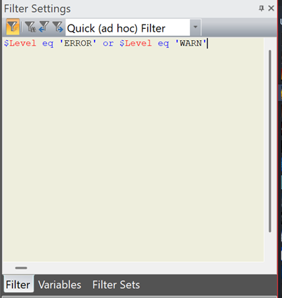

# Filtering

A **filter** hides every entry that does not match an expression you write. It is the feature Log Lion is built around: a log is mostly things you do not care about, and filtering is how you get from a million entries to the forty that matter.



## Writing one

Type an expression into the **Filter Settings** pane and apply it. The entry list clears and refills with the matching entries.

Expressions are written in the [Boolean Expression Language](filter-language.md). The simplest useful one is a bare word:

```

timeout
```

which shows every entry whose message contains that text. From there it grows as far as you need:

```

timeout and not health              a word, excluding the noise
$Level eq "ERROR"                   a column compared to a value
$Level eq "ERROR" or $Level eq "WARN"
$Duration > 5000                    a numeric comparison
$Thread eq "T-04" and retry         a column and a word together
```

The editor colors the expression as you type — column names, operators, strings and comments each get their own color — so a typo usually shows up before you run it. Errors are reported with the position when you apply it.

See [Boolean Expression Language](filter-language.md) for the full syntax and [Filter Samples](filter-samples.md) for expressions worth copying.

## The pane

| Tab | Holds |
| --- | --- |
| **Filter** | The expression editor. The drop-down at the top selects which filter you are editing; **Quick (ad hoc) Filter** is the scratch one you start in. |
| **Variables** | Named values you can refer to as `%name` in an expression. See below. |
| **Filter Sets** | Saved groups of filters. See below. |

**Filter ▸ Toggle Filter** switches the current filter off and on without losing it — the quickest way to check what a filter is hiding.

## Filter by column

**Filter ▸ Filter By** builds an expression from the entry you have selected: pick a column and Log Lion writes the comparison for you. Select an entry from the thread you are interested in, **Filter By ▸ Thread**, and you have that thread on its own without typing anything.

This is the fastest way to start, and a good way to learn the syntax — the expression it writes appears in the editor where you can extend it.

## Quick filter

The box on the toolbar is a quick filter: type and press Enter. It is the same machinery with less ceremony, for when you want one word and do not want to touch the pane.

## Saving filters

**Filter ▸ Save** keeps the current expression under a name so it is a couple of clicks away next time. Saved filters live in `%APPDATA%\Log Lion\Filters\`, and Log Lion writes a `SampleFilters` set there the first time it creates that folder — worth reading as examples.

Because they are files, a filter set is shareable. A team investigating the same service ends up with a set of filters that encode what its log means — "failed logins", "slow queries", "this customer" — and handing that to a new colleague is worth more than explaining the log to them.

### Filter sets

A **filter set** is a group of named filters kept together, listed on the **Filter Sets** tab and under **Filter ▸ Filters**. Open a set and its filters are one click each. Organize them however suits — one set per service, per incident type, or per customer.

### Variables

A variable lets you write an expression once and change what it looks for. Define `id` on the **Variables** tab and use it as `%id`:

```

$RequestId eq %id
```

Now the same saved filter follows whichever request you are chasing — change the variable, not the expression. Environment variables are available too, as `%env.NAME`, which is useful for a filter that should follow the machine it is run on.

Changing a variable invalidates the cached results, so filters using it are re-evaluated.

## Filtering is not the only way to narrow things down

This is worth knowing, because reaching for a filter every time is a common way to make life harder than it needs to be.

| If you want to… | Better tool |
| --- | --- |
| See matching entries *and* what surrounded them | [Color ▸ Filter Result Set](coloring.md) — marks matches in place instead of hiding the rest. |
| Find one occurrence and read around it | [Find](finding.md) (Ctrl+F). |
| Work on a time window | A [viewable range](limiting-the-range.md) — and it makes filters faster rather than slower. |
| Separate interleaved threads or sessions | [Color ▸ Column](coloring.md) — all of them at once, in context. |
| Keep a few key entries visible while filtering hard | [Filter ▸ Include Bookmarks](bookmarks.md). |

## Speed

Filtering runs on background threads, in parallel, over blocks of entries — the window stays responsive, results appear as they are found, and you can cancel or change the expression while it runs. On a large log:

- **Set a [range](limiting-the-range.md) first.** A filter costs time in proportion to the entries it examines.
- **Refer to one column where you can.** An expression that only mentions one column lets the log source parse just that field instead of the whole entry, which on a wide text format is a large difference.
- **Results are cached.** Going back to a filter you ran a moment ago is immediate. The cache holds the several most recent.

**Filter ▸ Show Statistics** reports entries per second and where the time went, if you want to see the effect of a change.

## Related

- [Boolean Expression Language](filter-language.md) — the full syntax.
- [Filter Samples](filter-samples.md) — expressions to copy.
- [Scripts](scripts.md) — when the question is more than a filter can express, a script can filter and compute in one pass.

---

[All documentation](README.md)
