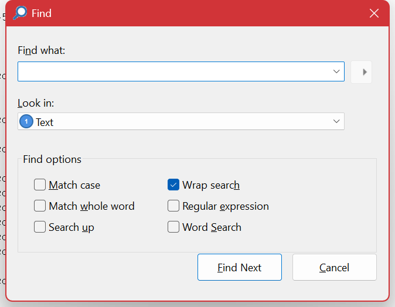

# Finding

**Edit ▸ Find** (Ctrl+F) searches the log for text and moves to the next entry that matches. **F3** repeats it and **Shift+F3** goes the other way.



## Find or filter?

This is the choice worth getting right, because the two feel similar and are good at opposite things.

|  | Find | [Filter](filtering.md) |
| --- | --- | --- |
| Shows | The whole log, cursor on a match | Only matching entries |
| Best for | "Where does *this* happen?" | "Show me all of *these*" |
| Keeps context | Yes — you see what came before and after | No — unmatched entries are hidden |
| Expressions | Text, regular expression, or boolean words | The full [expression language](filter-language.md) |

A common pattern is to filter first and find within the result: with a filter applied, Find only visits the entries the filter left.

## Find options

| Option | Meaning |
| --- | --- |
| **Look in** | Which column to search. Searching one column rather than the whole entry is *much* faster on a large log, because Log Lion then only has to parse that field. Leave it on the message column unless you know the value is elsewhere. |
| **Match case** | Off by default. `error` also finds `ERROR`. |
| **Match whole word** | Stops `id` matching inside `guid` and `identity`. |
| **Search up** | Search towards the start of the log instead of the end. |
| **Wrap search** | On by default. At the end of the log, continue from the beginning. |
| **Regular expression** | Treat the search text as a regular expression. See below. |
| **Word Search** | Treat the search text as boolean words. See below. |

### Regular expression search

Log Lion uses Perl-style regular expressions. Useful ones for logs:

| Pattern | Finds |
| --- | --- |
| `timeout after \d+ ?s` | A timeout with any number of seconds. |
| `\b\d+\.\d+\.\d+\.\d+\b` | An IPv4 address. |
| `(?i)fail(ed\|ure)?` | fail, failed or failure, any case. |
| `took (\d{4,}) ?ms` | Anything that took four or more digits of milliseconds — a cheap way to find the slow ones. |
| `^(?!.*health).*ERROR` | Errors that are *not* the health-check noise. |

Remember to escape the characters that are special to a regular expression when you mean them literally: `.` `?` `*` `+` `(` `)` `[` `]` `\`. A bare `.` matches any character, so `10.0.0.1` also matches `10a0b0c1`; write `10\.0\.0\.1`.

Regular expressions are also used for [highlighting](coloring.md), for several [analysis tools](analyzing.md), and for [custom parsed files](log-types-custom-parsed.md).

### Word Search

Boolean search over words, for when you know several things about an entry but not how it is phrased:

```

timeout database          both words, in any order, anywhere in the entry
timeout or refused        either word
timeout and not retry     the first without the second
"connection reset"        the exact phrase
```

This is the quickest way to find an entry you only half remember. When you need real precision — comparisons, column names, time arithmetic — a [filter](filtering.md) with the [expression language](filter-language.md) is the better tool.

## Searching a large log

Search runs on its own thread and does not block the window. Past about two seconds a progress dialog appears showing how far it has got, the rate in entries per second, and a **Cancel** button; below that threshold nothing appears at all, so quick searches stay quick.

If a search is slower than you would like:

- **Set *Look in* to one column.** The single biggest difference on a wide format.
- **Set a [viewable range](limiting-the-range.md).** Find only visits entries inside it.
- **Filter first.** Find then runs over the filtered result rather than the whole log.
- **Prefer plain text to a regular expression** where either would do.

## What to try when a search finds nothing

- **Wrong column.** *Look in* may be pointing at a column that does not contain the text. Check the **Fields** pane for an entry you know matches, to see which column the value really lives in.
- **A filter is hiding it.** Find only visits entries the filter allowed through. Clear the filter and try again.
- **A range is hiding it.** Same again for a viewable range — **View ▸ Range ▸ Clear All** (Ctrl+Shift+X).
- **Regular expression left on.** Text with a `.`, `(` or `*` in it means something different when that box is ticked.
- **Not indexed yet.** On a very large log, wait for the entry count in the status bar to stop climbing.

## Related

- [Navigating](navigating.md) — moving by entry, by time, by scope and by entry type, and stepping back through where you have been.
- [Bookmarks](bookmarks.md) — marking what you found so you can get back to it.
- [Coloring](coloring.md) — **Highlight Expression** marks every match at once instead of visiting them one at a time.

---

[All documentation](README.md)
