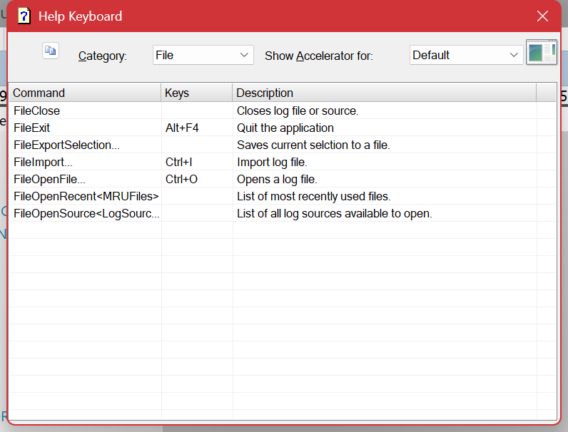

# Keyboard Shortcuts

**Help ▸ Hot Keys** lists every shortcut in the application, by category, with a description of each. It is generated from the application itself, so it is always current — consult it rather than a printed list when you want to be certain.

What follows is the smaller set worth committing to memory. Log Lion is considerably faster to drive from the keyboard than from the menus, and these are the keys that make the difference.

## The ones to learn first

| Key | Does |
| --- | --- |
| **Ctrl+F** / **F3** / **Shift+F3** | [Find](finding.md), find next, find previous. |
| **F4** | Toggle the [filter](filtering.md) off and on. The fastest way to see what a filter is hiding. |
| **Ctrl+B** / **Ctrl+E** | Set the [range](limiting-the-range.md) begin / end at the current entry. |
| **Ctrl+F2** / **F2** / **Shift+F2** | Toggle a [bookmark](bookmarks.md), next, previous. |
| **Alt+Left** / **Alt+Right** | Back and forward through where you have been. See [Navigating](navigating.md). |
| **F8** / **F7** | Next / previous entry of the same type — "the next error". |
| **Enter** | Entry details for the selected entry. |
| **F5** | Refresh. **Ctrl+F5** follows the log as it grows. See [Live Logs](live-logs.md). |

## File

| Key | Does |
| --- | --- |
| **Ctrl+O** | Open a log file. |
| **Ctrl+I** | Import with the [Text Log Wizard](log-types-text-log-wizard.md). |
| **Alt+F4** | Quit. |

## Selecting and copying

| Key | Does |
| --- | --- |
| **Ctrl+A** | Select all. |
| **Ctrl+C** | Copy. |
| **Alt+C** | Copy as simple text. |
| **Ctrl+Shift+C** | Copy as CSV. |
| **Alt+Insert** | Copy as rich text, with the colors. |
| **Ctrl+Insert** | Copy as HTML, with the colors. |
| **Ctrl+Shift+Insert** | Copy as XML. |

See [Exporting and Copying](exporting.md) for which to use where.

## Navigating

| Key | Does |
| --- | --- |
| **Ctrl+G** | Go to entry number. |
| **Ctrl+T** | Go to time. |
| **F10** / **Shift+F10** | Step over, forward / back. |
| **F11** / **Shift+F11** | Step into, forward / back. |
| **F12** / **Shift+F12** | Step out, forward / back. |
| **Shift+F7** / **Shift+F8** | First / last entry of this type. |

## Range

| Key | Does |
| --- | --- |
| **Ctrl+R** | Range settings. |
| **Ctrl+B** / **Ctrl+Shift+B** | Set / clear begin. |
| **Ctrl+E** / **Ctrl+Shift+E** | Set / clear end. |
| **Ctrl+Shift+X** | Clear the whole range. |

## Filtering and coloring

| Key | Does |
| --- | --- |
| **F4** | Toggle the filter. |
| **Shift+F4** | Clear the filter. |
| **Ctrl+F4** | Filter settings. |
| **Ctrl+0**…**Ctrl+9** | Apply a saved filter by position. **Ctrl+Shift+** and **Alt+** with a digit reach further into the set. |
| **Ctrl+Shift+R** | [Highlight expression](coloring.md). |
| **Ctrl+Shift+S** | Color by the filter result set. |
| **Ctrl+Shift+M** | Include bookmarked entries in the filter. See [Bookmarks](bookmarks.md). |

The numbered filter shortcuts are the reason to keep a [filter set](filtering.md) in a deliberate order: once "errors" is **Ctrl+1** and "this customer" is **Ctrl+2**, moving between views of the same log costs nothing.

## Window

| Key | Does |
| --- | --- |
| **Alt+Shift+Enter** | Full screen. |
| **Ctrl+Tab** / **Ctrl+Shift+Tab** | Move between panes. |
| **F1** | This help. |

## Where these come from

The key shown beside a menu item is not typed into the menu — Log Lion renders it from the accelerator table, so the menu and the keys cannot drift apart. If a menu item and this page ever disagree, **Help ▸ Hot Keys** is the one to believe: it is generated from the same table.

---

[All documentation](README.md)
