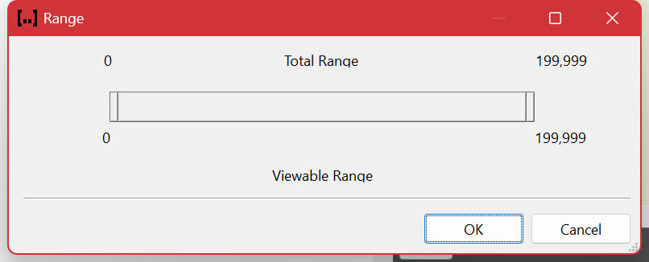

# Limiting the Range

A **viewable range** narrows the log to a span of entries. Everything afterwards — filtering, Find, the analysis tools, scripts, export — operates on that span and ignores the rest.

## Why it matters

Two reasons, and the second is the one people underestimate.

**Focus.** The incident happened between 02:14 and 02:20. The other eleven hours in the file are noise, and every filter you write has to be made more specific just to exclude them. Set the range once and stop thinking about them.

**Speed.** Filtering, searching and the tools all cost time proportional to the number of entries they look at. Cutting a 4 GB log down to the ten minutes that matter makes everything afterwards faster by the same proportion — often the difference between an interactive loop and one where you wait for each attempt. On a large log this is the single most effective thing you can do before you start experimenting with filters.

## Setting a range

| Command | Key |
| --- | --- |
| **Set Begin** at the current entry | Ctrl+B |
| **Clear Begin** | Ctrl+Shift+B |
| **Set End** at the current entry | Ctrl+E |
| **Clear End** | Ctrl+Shift+E |
| **Clear All** | Ctrl+Shift+X |
| **Range Settings** | Ctrl+R |

All under **View ▸ Range**. The quickest way in practice is to select the entry where things start going wrong and press **Ctrl+B**, then the entry where it is over and press **Ctrl+E**.

**Ctrl+R** opens the settings, where the range can be typed exactly — as entry numbers or as times — rather than found by scrolling.

You can also set a range by dragging across the [timeline](timeline.md) in the **Range** pane, which is the natural way to do it when you are thinking in terms of when rather than which entry.

## Range and filters are different things

|  | Range | Filter |
| --- | --- | --- |
| Selects by | Position — a contiguous span | Content — anything matching, anywhere |
| Result | A shorter log | A scattered subset |
| Makes later work | Faster | Slower, until it has run |

They compose, and the useful order is **range first, filter second**: the range makes the filter cheaper, not the other way round.

## Things a range affects

- **Filtering** only considers entries inside it.
- **Find** only visits entries inside it — a frequent cause of "the text is definitely in there and Find cannot see it".
- **The analysis tools** and **scripts** run over it, and report the range they used.
- **Export** and **Select All** act within it.

Nothing is lost. A range hides entries; it never removes them, and **Ctrl+Shift+X** brings the whole log back at once.

## Related

- [The Timeline](timeline.md) — where a range is easiest to set and to see.
- [Filtering](filtering.md) — selecting by content instead.
- [Finding](finding.md) — remember that a range constrains it.

---

[All documentation](README.md)
