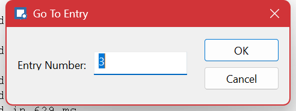

# Navigating

Beyond scrolling, Log Lion can move by **entry number**, by **time**, by **entry type**, and by **scope** — and it remembers where you have been so you can get back.

## Go To

| Command | Key | Does |
| --- | --- | --- |
| **Go To ▸ Entry** | Ctrl+G | Jump to an entry by number. Entries are numbered from 0. |
| **Go To ▸ Time** | Ctrl+T | Jump to a moment. Lands on the first entry at or after the time you give. Needs the log to have a time field. |
| **Backward** | Alt+Left | Back to where you were before the last jump. |
| **Forward** | Alt+Right | Forward again. |

**Backward and Forward are the ones to remember.** Log Lion keeps a history of the places you jumped from, exactly like a browser's back button, so you can follow a trail through a log — search, jump, look around, jump again — and unwind it without losing your place. The toolbar's **Back** button has a drop-down listing recent positions.

**Go To Time** is greyed out when the log has no time field. The **Source Info** pane says which column is being used as the time field, and **View ▸ Settings** is where you nominate one if the format did not work it out.

## Navigate Types

Every entry has a **type** — error, warning, information, and whatever else the format defines. These four commands move between entries of the *same type as the one you are on*, which makes "show me the next error" a single keystroke rather than a filter.

| Command | Key |
| --- | --- |
| First entry of this type | Shift+F7 |
| Previous entry of this type | F7 |
| Next entry of this type | F8 |
| Last entry of this type | Shift+F8 |

Select an error, then press **F8** repeatedly to walk the errors while still seeing everything around each one. The toolbar has a type picker if you would rather choose the type than select an entry of it first.

On a format with only one entry type — a plain text file, for instance — these do nothing useful. Use a [filter](filtering.md) on the text instead.

## Navigate Context — stepping through scopes

Some logs are structured rather than flat. A trace that records function entry and exit, or a log with a thread or session column, has a shape to it: entries belong to a **navigation context**, and they nest.

When a format provides that, Log Lion navigates it the way a debugger navigates code:

| Command | Key | Does |
| --- | --- | --- |
| **Step Over** | F10 | Next entry at the same nesting level, skipping anything nested inside. |
| **Step Over Back** | Shift+F10 | The same, backwards. |
| **Step Into** | F11 | The next entry, including nested ones. |
| **Step Into Back** | Shift+F11 | The same, backwards. |
| **Step Out** | F12 | Out to the enclosing scope. |
| **Step Out Back** | Shift+F12 | The same, backwards. |

This turns a wall of interleaved trace output into something you can read at the level you care about: **F10** along the top-level operations until one looks wrong, **F11** into it, **F12** back out when it is not the problem.

Which column defines the context is part of the format — commonly a thread or session identifier — and the indent you see in the entry list is the nesting level. [Open Scopes](tools-open-scopes.md) finds contexts that were entered and never left, which is the usual sign of a hang or a leak.

## Where am I?

- The **status bar** shows the current entry number and how many entries are selected.
- The **Range** pane shows the whole log's shape, so you can see roughly where you are in it. See [The Timeline](timeline.md).
- The **Preview** pane shows the current entry in full while the list keeps its position.

## Related

- [Finding](finding.md) — searching for text rather than moving to a known place.
- [Bookmarks](bookmarks.md) — F2 and Shift+F2 move between marks you set yourself.
- [Limiting the Range](limiting-the-range.md) — every command here stays inside the range you set.

---

[All documentation](README.md)
