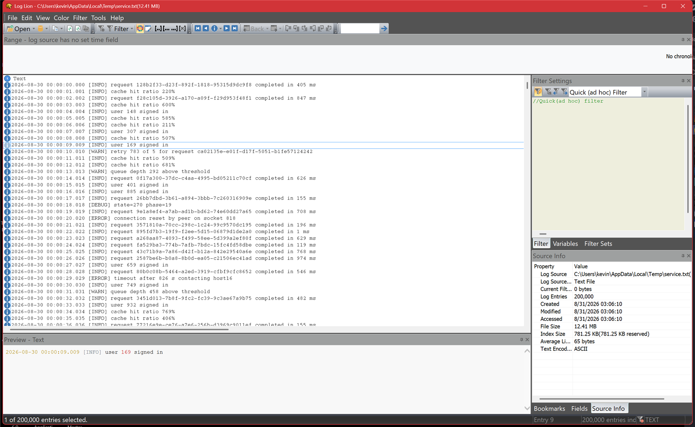
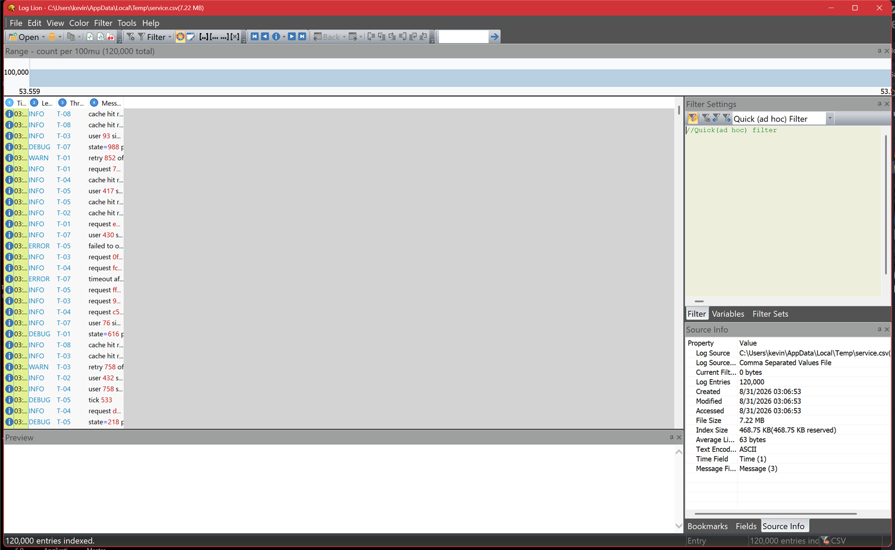

# Reading a Log

## The parts of the window

| Part | What it is for |
| --- | --- |
| **Entry list** (the middle) | One row per log entry. This is the log. |
| **Range** (across the top) | The [timeline](timeline.md): when the entries happened, and how many at each moment. Also where you set a [viewable range](limiting-the-range.md). |
| **Preview** (bottom) | The selected entry in full, wrapped, with syntax coloring. Useful when a message is far too long for its column. |
| **Filter Settings** (right) | The filter expression editor, plus tabs for **Variables** and **Filter Sets**. See [Filtering](filtering.md). |
| **Source Info** (right) | Facts about the open log: path, format, entry count, file size, index size, encoding, and which columns are the time and message fields. |
| **Bookmarks** / **Fields** (right, tabbed) | Your [bookmarks](bookmarks.md), and the columns of the selected entry as a name/value list. |
| **Status bar** (bottom) | Indexing progress, how many entries are selected, the current entry number, and the log format. |

Every panel around the edge is a **pane**. Panes can be dragged to another edge, stacked into tabs, floated as a separate window, or closed — use **View ▸ Tool Bars & Panes** to bring one back. Your arrangement is remembered between sessions.

**View ▸ Full Screen** (Alt+Shift+Enter) hides everything except the entry list.

## Entries

Log Lion numbers every entry in the log, starting at **entry 0**. That number is what **Go To**, bookmarks and scripts all refer to, and it does not change when you filter — entry 4,001 is the same entry whatever else is on screen.

The icon at the left of each row is the entry's **type**: error, warning, information, and so on. What types exist depends on the format — a Windows Event Log classifies every record, whereas a plain text file has only one type and the severity, if any, is just words inside the message. **Edit ▸ Navigate Types** jumps between entries of the same type as the current one; see [Navigating](navigating.md).

### Selecting

Click to select an entry, Shift+click to extend, Ctrl+click to add one, and **Ctrl+A** to select everything. The status bar keeps a count. A selection is what [Copy and Export](exporting.md) act on.

### Entry details

Press **Enter** (or **View ▸ Entry Details**) for the whole entry in a window of its own, every column laid out as a name/value list. This is the one to reach for with formats that carry far more per entry than fits on a row — Windows Event Log records, HAR requests, ETL events.

## Columns

Columns come from the log's format. A CSV has whatever its header row says; a Windows Event Log has the event's fields; a plain text file has a single **Text** column. The [Import Text Log Wizard](log-types-text-log-wizard.md) and [custom parsed files](log-types-custom-parsed.md) are how you give an unusual text format real columns.

- **Resize** by dragging the divider in the header; double-click a divider to fit the contents.
- **Reorder** by dragging a header.
- **Sort** by clicking a header, where the format supports it.
- **Show and hide** columns from the header's context menu.

Two columns have special standing, and the **Source Info** pane names them: the **time field** and the **message field**. The time field drives the [timeline](timeline.md) and **Go To Time**. The message field is what Log Lion treats as "the text of the entry" — it is what a bare word in a [filter](filtering.md) searches, and what **Preview** shows. If a log opens with no time field, use **View ▸ Settings** to nominate one.

## Syntax highlighting

Log Lion colors structure inside the message text without being told anything about the format — numbers, quoted strings, name=value pairs, GUIDs and identifier-like slugs each get their own color. It is on by default (**Color ▸ Syntax Highlighting**) and it is usually the fastest way to pick a value out of a dense line.

That is only one of several coloring modes, and the others are considerably more powerful — see [Coloring](coloring.md).

## Large logs

Log Lion is designed for files up to about 4 GB, and does not read one into memory. What it builds is an **index** — the position of every entry — and the **Source Info** pane reports how big that index is. Entries are parsed only when they are about to be drawn.

Practical consequences:

- You can start reading immediately. Indexing continues in the background and the entry count in the status bar climbs as it goes.
- Scrolling to the end of a huge log is instant; it does not have to read everything in between.
- Filters and searches run on background threads, so the window stays responsive and you can cancel.
- If a log is bigger than the part you care about, a [viewable range](limiting-the-range.md) makes everything afterwards faster.

## Several logs at once

Log Lion shows one log at a time in a window. To compare two, open a second copy of Log Lion and put the windows side by side; **View ▸ Synchronize** keeps two windows scrolled to the same moment in time, which is what you want when following a request across two services.

---

[All documentation](README.md)
