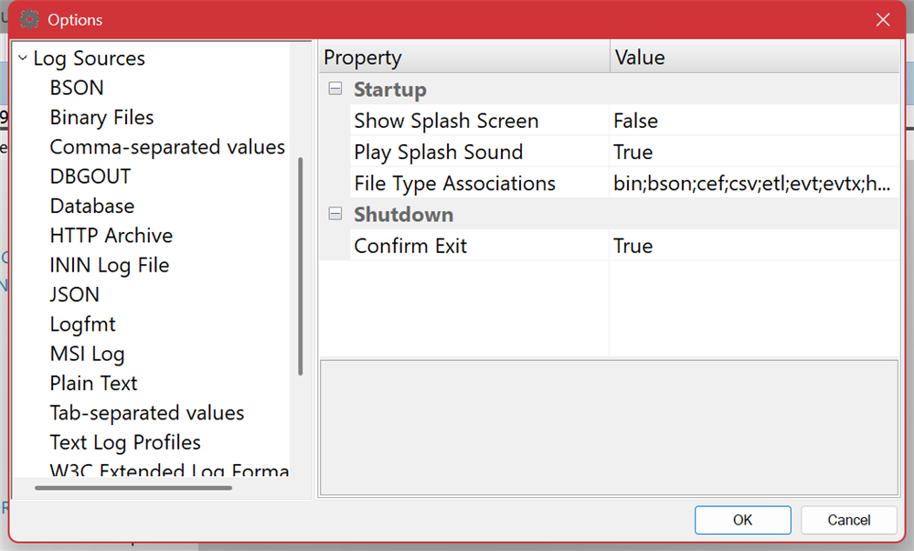

# Settings and Options

**View ▸ Settings** opens the options. Categories are on the left; the properties for the selected category are on the right, with a description of each as you select it.

## Application settings

| Setting | Meaning |
| --- | --- |
| **Show Splash Screen**, **Play Splash Sound** | Startup behavior. |
| **File Type Associations** | Which extensions open in Log Lion when you double-click them. Log Lion offers to set these the first time it runs; this is where to change your mind. |
| **Confirm Exit** | Ask before quitting on Alt+F4. |
| **Confirm Open Next File** | Ask before moving on to the next file in a series. |
| **Font**, **Fixed Font** | The font used for the entry list. A fixed-pitch font keeps columns of text aligned, which is usually what you want for a log; a proportional font fits more on screen. |
| **Scale Toolbar Icons** | Larger toolbar images on high-DPI displays. |
| **Tool Tips** | **Single line** or **Multi-line** tips in the entry list — multi-line is the readable choice for long messages. |

## Display and coloring

| Setting | Meaning |
| --- | --- |
| **Color Whole Rows** | Whether [coloring](coloring.md) fills the entire row or only the column it derives from. |
| **Color Alternating Rows** | Shade every N rows. The count is configurable, so you can band by three or five rather than one. |
| **Color by Time** | Shade entries by which time bucket they fall in. |
| **Time Series Interval** | The bucket size for the [timeline](timeline.md) and for coloring by time — hours, minutes, seconds, milliseconds, microseconds or nanoseconds. Set it to match the timescale of what you are investigating. |
| **Show Indention** | Indent nested entries by their [scope depth](navigating.md). |
| **Reset Syntax Coloring Rules** | Write the built-in [syntax highlighting](coloring.md) rules back out, discarding your edits. |

## Finding and filtering

| Setting | Meaning |
| --- | --- |
| **Select Found Entries** | Whether [Find](finding.md) adds each match to the selection as it goes. Useful when you intend to copy every match once the search finishes. |
| **Wrap Bookmark Search** | Whether F2 continues from the top after the last [bookmark](bookmarks.md). |
| **Include Bookmarks** | The default for whether filters keep bookmarked entries. |
| **Autosave Filters**, **Filter File** | Whether filters are saved automatically, and which filter file loads at startup. See [Filtering](filtering.md). |
| **Prompt for Variables** | Ask for the value of a `%variable` when a filter that uses one is applied. |
| **Show Stats** | Report entries per second and timing after a filter or a tool runs. Worth turning on while tuning a slow filter or a [script](scripts.md). |
| **Left-to-Right AND/OR** | Take AND and OR from left to right, as Log Lion did before version 3.1.4, so `a OR b AND c` means `(a OR b) AND c`. Off by default: AND binds tighter than OR. See [Boolean Expression Language](filter-language.md). |
| **Max Processing Stages** | How many worker threads filtering may use. It defaults to the number of processors, which is the right answer almost always. Lower it only to leave headroom for something else running on the machine. |

## Per-format settings

**File ▸ Source Settings** holds the settings that only make sense for one log format. Pick the format from the **Source** list at the top — **Plain Text**, **Comma-separated values**, **Database**, **Binary Files**, and so on — and its settings fill the dialog below it: encoding, delimiters, which column is the timestamp, how to parse it. You can change several formats before choosing **OK**; each keeps your changes while you look at another. When the open log is of the format you change, it picks up the new settings at once, and is reopened if they change its columns or number of entries.

These are the same settings the format's own topic describes, gathered in one place so you can set a default rather than change it per file. Two are worth knowing about generally:

- **The time field.** If a log opens with no timestamp — the [timeline](timeline.md) is empty and **Go To Time** is greyed — this is where you nominate the column and its format.
- **File Series** and **File Name Mask**. How Log Lion recognizes a log that has been rolled over into numbered or dated files, so it can follow from one to the next. See [Live Logs and Refresh](live-logs.md).

## Time zones

Times are shown in your local zone. Where a log records UTC and you need it to line up with something else you are reading, the display offset can be adjusted in the format's **File ▸ Source Settings**. Nothing in the log is altered — only how it is presented.

## Settings that live elsewhere

| Setting | Where |
| --- | --- |
| Toolbar and menu contents | **Tools ▸ Customize** |
| Your own programs on the Tools menu | [Tools ▸ Customize ▸ Tools](external-tools.md) |
| Which panes are visible | [View ▸ Tool Bars & Panes](toolbars-and-panes.md) |
| Highlight rules and regex profiles | [Color ▸ Highlight Expression](coloring.md) |
| Which extensions are trusted | [Tools ▸ Extensions](extensions.md) |

Where each of these is stored on disk is listed in [Where Log Lion Keeps Your Data](data-folder.md).

---

[All documentation](README.md)
