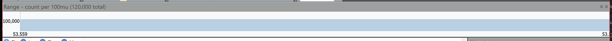

# The Timeline

The **Range** pane across the top of the window plots the log against time: how many entries happened at each moment, from the first to the last.

It is a small strip and easy to ignore, which is a pity, because it answers the question you usually have first: *when did this go wrong?* A burst, a gap, or a step change in volume is visible in it immediately — and none of those are things you would find by reading entries in order.

## What to look for

| Shape | Usually means |
| --- | --- |
| A spike | A retry storm, a flood of errors, or a job that ran. Drag across it to look only at that. |
| A gap | Something stopped. A process died, a disk filled, logging was blocked, or the machine was not running. |
| A step up that never comes down | A change in behavior rather than an event — a bad deployment, a leak, a new caller. |
| Regular pulses | A scheduled job or a health check. Worth filtering out so it stops drowning everything else. |

## Using it

- **Drag across it** to set a [viewable range](limiting-the-range.md) over that span. This is the fastest way to say "just this bit", and it makes everything you do next faster.
- The pane's caption reports the bucket size and the total — for example *count per 100mu (120,000 total)* — so you can tell what one bar represents.
- It reflects the current [filter](filtering.md), so with a filter applied you are seeing when the *matching* entries happened, not all of them. Filter to errors and the timeline becomes a picture of when the errors were.

## "No chronological range"

If the pane says the log source has no set time field, the format did not identify a timestamp column, and the timeline has nothing to plot. A plain text file is the common case — the timestamps are in the text, but nothing has told Log Lion which part of the line they are.

Fix it in one of these ways:

- **View ▸ Settings** — nominate an existing column as the time field.
- [Import Text Log Wizard](log-types-text-log-wizard.md) — split the line into real columns, including a time column, and save it as a reusable profile.
- [Custom parsed files](log-types-custom-parsed.md) — the same idea with a regular expression.

It is worth doing. A time field is what makes the timeline, **Go To Time**, time comparisons in [filter expressions](filter-language.md), and time arithmetic in [scripts](scripts.md) all work.

## Time zones

Times are displayed in your local time zone by default. Where a log records UTC and you are reasoning about local events — or comparing against a colleague in another zone — the display offset can be adjusted in **View ▸ Settings**, so the log lines up with whatever else you are reading.

## Related

- [Limiting the Range](limiting-the-range.md) — what dragging on the timeline sets.
- [Histogram](tools-histogram.md) — counts by value rather than by time.
- [Navigating](navigating.md) — **Go To Time** jumps to a moment.

---

[All documentation](README.md)
