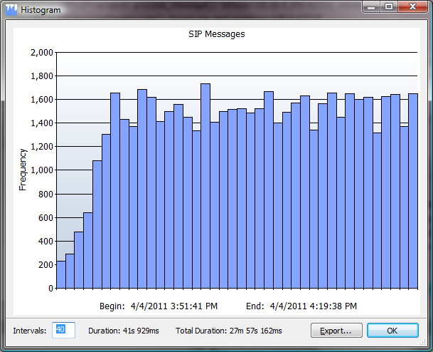

# Histogram

The histogram tool can be invoked on the entire log or a filtered view, even while a filter operation is in progress. The tool creates a vertical bar graph depicting the distribution of log entries (frequencies) over fixed time intervals. The histogram is only available for log sources that define a time stamp attribute.

A histogram is great for identifying skews, peaks, and gaps. It is quickly calculated because it is only counting log entires within a fixed time interval and does not need to visit each entry. It's good for quickly determining the shape of your data.

 ## Histogram Dialog

The histogram dialog offers the following **fields**:

| Frequecy | Number of entries in the inteval (Y-axis). The axis is dynamically scaled. |
| --- | --- |
| Begin | Beginning time range date and time. |
| End | Ending time range date and time. |
| Intervals | The number of intervals to display in the graph for the (X-axis). Valid range 0-999, default 40. |
| Duration | Time duration of a single interval. |
| Frequecy | Total time duration being depict by all intervals in range (End - Begin). |

The histogram dialog offers the following **commands**:

| Double Left Click Interval | Close dialog and goto the first log entry in the interval. |
| --- | --- |
| Export... | Save data in table form as a csv file. |
| OK | Close the histogram dialog. |

---

[All documentation](README.md)
