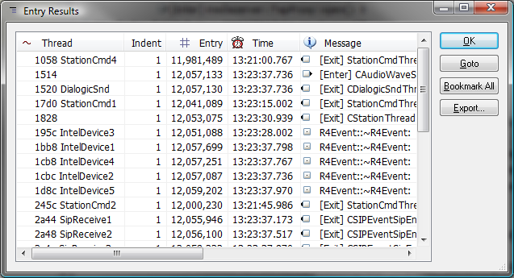

# Open Scopes

The open scopes tool can be invoked on the entire log but not a filtered view. Finds the last log entries of each navigation context which opened a scope but hasn't closed the scope by the end of the log or set range. Only available for log sources that define a navigation context attribute such as a thread id.

Open Scopes is great at finding the last statements of an incomplete thread or operation which is probably hung or dormant. Find two or more threads involved in a dead lock.

## Open Scopes Results Dialog

The results shows the last log entry of each navigation context.

 The open scopes results dialog offers the following **fields**:

| Context | The navigation context value such as "Thread". |
| --- | --- |
| Indention | The indention, or depth level, of the last log entry. This is useful in determining relevancy of a leaked resource as top level items often are expected not to terminate within the same log instance they were started. |
| Entry | The entry number of the log entry of the first match. |
| Time | If available in the log source, the time stamp of the last log entry. |
| Message | The Message attribute of the last log entry. |

The open scopes results dialog offers the following **commands**:

| Double Left Click | Executes the Goto command on the clicked item. |
| --- | --- |
| OK | Closes the dialog. |
| Goto | Closes the dialog and jumps to the log entry of the unmatched pair item that is currently selected. |
| Bookmark All | Closes the dialog and then bookmarks all entries that was in the results table. |
| Export... | Save the open scopes results table as a csv file. |

---

[All documentation](README.md)
