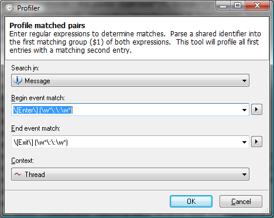
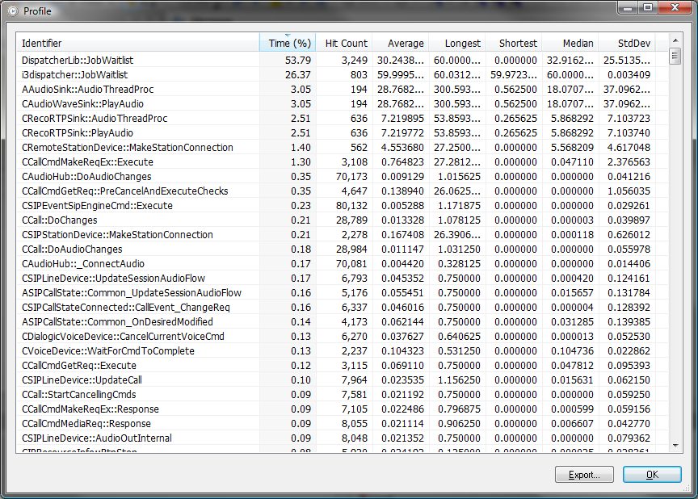

# Profiler

The profiler tool can be invoked on the entire log but not a filtered view. The tool Uses regular expressions to identify and match a pair of log entries in which to create a timed interval. Statistics are calculated for each time interval and each identifier with its corresponding statistics are displayed in a table. Only available for log sources that define a time stamp attribute.

Profiler is great at analyzing the duration and performance of operations. An operation can be a function call, a pair of asynchonous events, or any pair of data that share an identifier for the start and end.

## Profiler Dialog

 The profiler dialog offers the following **fields**:

| Search in | The attribute column to search for the begin and end events. |
| --- | --- |
| Begin event match | A regular expression to match the begin event. The first matching group ($1) will be extracted and must match the first matching group of the end event. |
| End event match | A regular expression to match the end event. The first matching group ($1) will be extracted and must match the first matching group of the begin event. |
| Context | The attribute column that both the begin and end events share. For example this could be "Thread" or some other shared context. |

The profiler dialog offers the following **commands**:

| OK | Execute the profiler operation and display the output when complete. |
| --- | --- |
| Cancel | Close the dialog aborting the profiler operation. |

## Profiler Output Dialog

 The profiler output dialog offers the following **fields**:

| Identifier | The shared identifier parsed from the first matching group ($1). |
| --- | --- |
| Time (%) | Percentage of time this identifier took from the total of all identifiers. |
| Hit Count | Total number of occurences. |
| Average | Average (mean) duration of this identifier. Time durations may be smaller than what was logged due to division. |
| Longest | Duration of the longest running sample of the identifier (max). |
| Shortest | Duration of the shortest running sample of the identifier (min). |
| Median | Middle duration separating the higher half durations from the lower half. |
| StdDev | Standard Deviation of the durations, which is the amount of variation or dispersion from the average. |

The profiler output dialog offers the following **commands**:

| Export... | Save the performance results table as a csv file. |
| --- | --- |
| OK | Closes the dialog. |

---

[All documentation](README.md)
