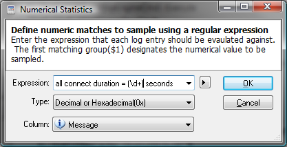
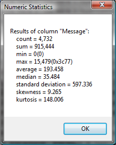

# Statistics

The statistics tool can be invoked on the entire log or a filtered view. The tool uses a regular expression to identify numerical samples. Samples are accumulated to determine the total count, sum, min, max, average, median, standard deviation, skewness, and kurtosis.

Statistics is great for analyzing numeric values in a log such as queue length.

## Numerical Statistics Dialog

 The statistics dialog offers the following **fields**:

| Expression | A regular expression to match and extract numerical samples. The first matching group *$1* designates the numeric value to sample. |
| --- | --- |
| Type | The numerical format type for parsing. If the number format doesn't include a base prefix then a specific base can be selected. |
| Column | The column (log entry attribute) to evaluate the expression against. |

The statistics dialog offers the following **commands**:

| OK | Execute the statistics operation and display the output when complete. |
| --- | --- |
| Cancel | Close the dialog aborting the statistics operation. |

## Statistics Output Dialog

 The statistics dialog offers the following **fields**:

| count | The amount of samples found. |
| --- | --- |
| sum | The total sum of the sample values. |
| min | The smallest value found. |
| max | The largest value found. |
| average | The mean or middle value of all the sample values. |
| median | The numerical value separating the higher half of the samples from the lower half. |
| standard deviation | The amount of variation or dispersion from the average. Low standard deviation indicates the sample values are very close to the average value while high standard deviation indicates the sample values are spread out over a large range. |
| skewness | A descriptor of the shape of a probability distribution. The measure of the asymmetry of the sample values from the average value. A negative value indicates more values fall to the left of the average while a positive value indicates more values fall to the right of the average value. |
| kurtosis | A descriptor of the shape of a probability distribution. The measure of the peakedness of the sample values or bulging of the values. |

The statistics dialog offers the following **commands**:

| OK | Closes the dialog. |
| --- | --- |

---

[All documentation](README.md)
