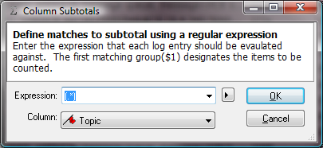
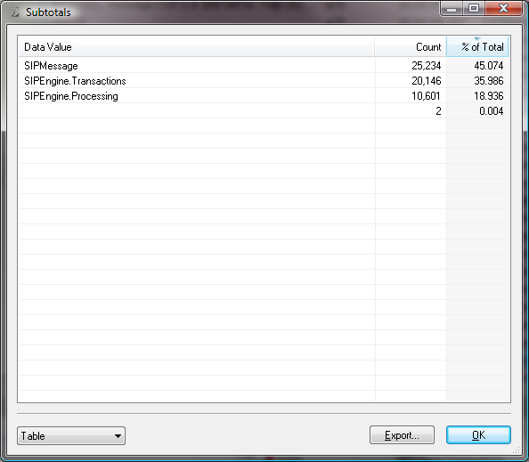

# Subtotals

The subtotals tool can be invoked on the entire log or a filtered view, even while a filter operation is in progress. The tool creates a table, pie chart, or bar graph of the sums of subitems. Subitems are identified by a regular expression matching against any column.

Subtotals is great for counting items in a group.

## Column Subtotals Dialog

 The subtotals dialog offers the following **fields**:

| Expression | A regular expression to match a group. The counted subitem will be parsed from the first matching group *$1*. |
| --- | --- |
| Column | The column (log entry attribute) to evaluate the expression against. |

The subtotals dialog offers the following **commands**:

| OK | Execute the subtotal operation and display the output when complete. |
| --- | --- |
| Cancel | Close the dialog aborting the subtotal operation. |

## Subtotals Output Dialog

 The subtotals dialog offers the following **fields**:

| Data Value | Subitem label extracted from the first matching group of the regular expression. |
| --- | --- |
| Count | The total number of subitems found. |
| % of Total | The count as a percentage of the total of all matching subitems. |

The subtotals dialog offers the following **commands**:

| Display Drop Down | Select *Table*, *Bar Chart*, or *Pie Chart*. |
| --- | --- |
| Export... | Save data in table form as a csv file. |
| OK | Execute the subtotal operation and display the output when complete. |

---

[All documentation](README.md)
