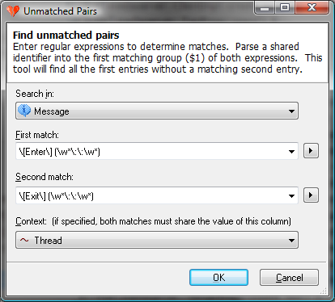
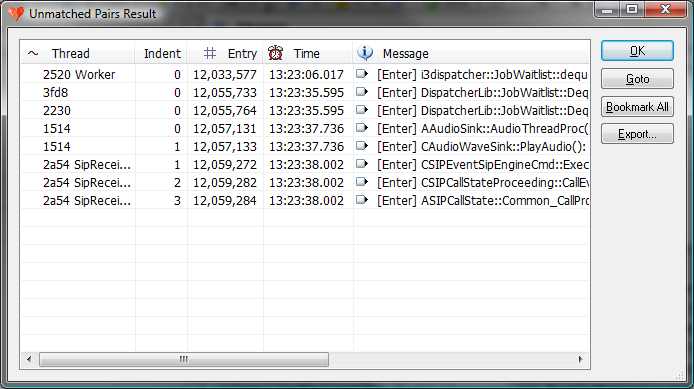

# Unmatched Pairs

The unmatched pairs tool can be invoked on the entire log but not a filtered view. The tool uses regular expressions to identify and match a pair of log entries where the second entry is missing. Displays all the first log entries that do not have a matching second log entry.

Unmatched Pairs is great at finding leaked resources, incomplete operations, and dead locked function invocations.

## Unmatched Pairs Dialog

 The unmatched pairs dialog offers the following **fields**:

| Search in | The attribute column to search for the first and second matches. |
| --- | --- |
| First match | A regular expression to match the first item. The first matching group ($1) will be extracted and must match the identifier extracted from the Second match. |
| Second match | A regular expression to match the second item. The first matching group ($1) will be extracted and must match the identifier extracted from the First match. |
| Context | The attribute column that both the begin and end events share. For example this could be "Thread" or some other shared context. |

The unmatched pairs dialog offers the following **commands**:

| OK | Execute the unmatched pairs operation and display the results when complete. |
| --- | --- |
| Cancel | Close the dialog aborting the unmatched pairs operation. |

## Unmatched Pairs Results Dialog

The results shows all the first matches that did not have a corresponding second match and therefore could be incomplete operations or leaked resources.

 The unmatched pairs results dialog offers the following **fields**:

| Context | The context value. |
| --- | --- |
| Indention | The indention, or depth level, of the of the first match if available. This is useful in determining relevancy of a leaked resource as top level items often are expected not to terminate within the same log instance they were started. |
| Entry | The entry number of the log entry of the first match. |
| Time | If available in the log source, the time stamp of the log entry of the first match. |
| Message | The Message attribute of the log entry. |

The unmatched pairs results dialog offers the following **commands**:

| Double Left Click | Executes the Goto command on the clicked item. |
| --- | --- |
| OK | Closes the dialog. |
| Goto | Closes the dialog and jumps to the log entry of the unmatched pair item that is currently selected. |
| Bookmark All | Closes the dialog and then bookmarks all entries that was in the results table. |
| Export... | Save the unmatched pairs results table as a csv file. |

---

[All documentation](README.md)
