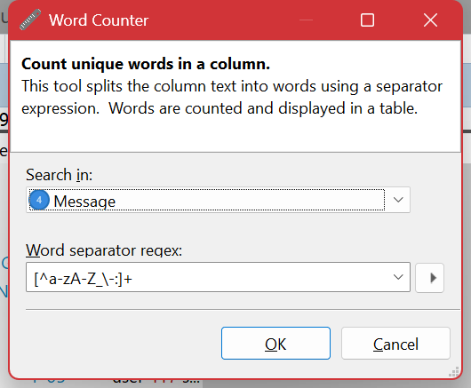
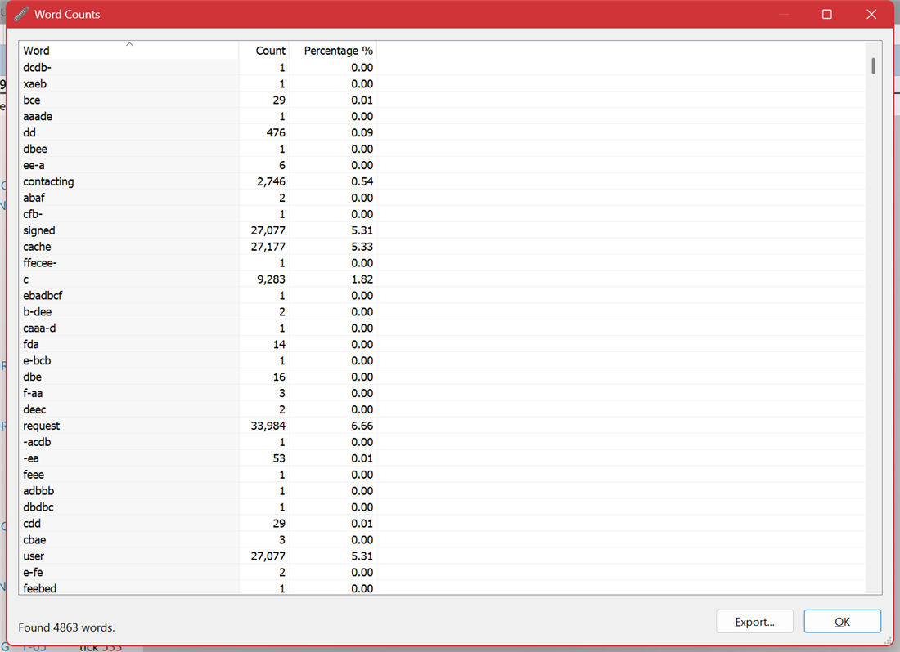

# Word Counter

**Tools ▸ Word Counter** splits a column into words and counts how often each one occurs, over every entry in the viewable range.

## What it is for

[Subtotals](tools-subtotals.md) counts *whole column values*, which is what you want for a column like **Level** or **Thread** where the value is one token. It is no use at all on a free-text message column, because every message is very nearly unique.

Word Counter is the answer for that column. It looks *inside* the text. Reach for it when you have opened a log from a system you do not know and want to see what it talks about at all — the vocabulary of a log is a fast summary of what it does, and of what goes wrong most.

Typical uses:

- **Learning an unfamiliar log.** The nouns tell you the domain; the verbs tell you the operations.
- **Spotting the dominant failure.** If `timeout` appears 40,000 times and `refused` twice, you know which one to chase first.
- **Finding the noise.** A word appearing on nearly every line is usually a heartbeat or a health check worth filtering out before you look at anything else.
- **Finding the vocabulary to filter on.** It tells you the exact spelling and case that the log actually uses, which saves guessing at a [filter expression](filtering.md).

## Options

| Option | Meaning |
| --- | --- |
| **Search in** | Which column to split into words. Normally the message column. |
| **Word separator regex** | A regular expression matching whatever comes *between* words. The text is split on it. The default is `[^a-zA-Z\-:]+` — anything that is not a letter, hyphen or colon. |

## Results

Each row is a word, how many times it occurred, and what share of the total that is. Click a column heading to sort — **sort by Count, descending**, which is almost always what you want and is not the order the results arrive in. **Export** writes the table to CSV and **Ctrl+C** copies the selected rows.

## Tuning the separator

The separator expression is the whole skill of this tool, and the default will not suit every log. Look at the screenshot above: the log is full of GUIDs, and because the default treats hyphens as part of a word, every GUID has shattered into fragments like `dcdb-` and `ffecee-`, each occurring once. Thousands of rows of noise around the handful that mean something.

Two ways to deal with that:

| Separator | Effect |
| --- | --- |
| `[^a-zA-Z]+` | Letters only. Digits, hyphens and punctuation all become separators, so identifiers and numbers stop appearing as words. **The one to try first on a noisy log.** |
| `[^a-zA-Z\-:]+` | The default. Keeps hyphenated words and `namespace:name` pairs together — good for logs full of hyphenated identifiers, bad for logs full of GUIDs. |
| `\s+` | Whitespace only. Every token exactly as written, punctuation included. Use when the punctuation is meaningful. |
| `[^a-zA-Z0-9_]+` | Identifier-shaped words, as a programming language would see them. Good for logs that name functions and variables. |

If the results are dominated by single-occurrence junk, the separator is wrong for that log. Change it and run again — it is quick.

## Getting a better count

- **Set a [range](limiting-the-range.md) first.** Word counts over an entire multi-gigabyte log are usually less interesting than counts over the ten minutes that went wrong, and much slower to produce.
- **Counts are case sensitive.** `Timeout` and `timeout` are counted separately, which is occasionally what you want and usually not. Bear it in mind when reading the totals.
- **The tool is unavailable while a filter is applied.** It works on the viewable range, not on a filtered result. To count within a subset, express the subset as a [range](limiting-the-range.md), or use a [script](scripts.md), which can filter and count in one pass.

## When you need something else

| If you want… | Use |
| --- | --- |
| Counts of whole column values | [Subtotals](tools-subtotals.md) |
| Counts of a pattern rather than a word | [Statistics](tools-statistics.md) |
| Counts grouped by something you define | [Scripts](scripts.md) |
| Counts over time | [The Timeline](timeline.md) |

---

[All documentation](README.md)
